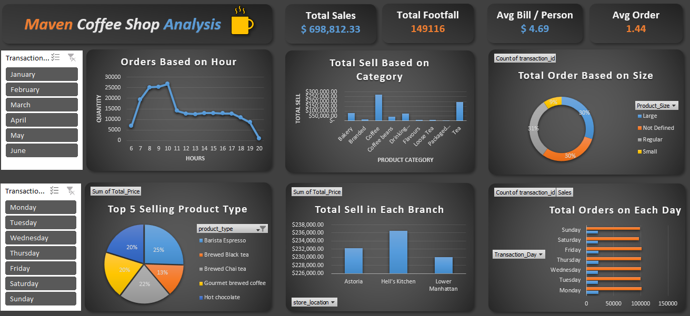

# ☕ Maven - Coffee Shop Sales Analysis & Interactive Dashboard

> A data analytics project showcasing my work as a **Data Analyst and Business Analyst Support** on 150,000+ coffee shop sales records, using Excel, Power Query, Pivot Tables, and interactive dashboards to analyze sales trends, revenue, product performance, and customer behavior.


---

## 📊 Project Overview

This project focuses on analyzing **150,000+ coffee shop sales transactions** using **Microsoft Excel, Power Query, Pivot Tables, advanced Excel functions, and data visualization techniques**.

The objective was to transform raw transactional data into a clean, structured dataset and develop an **interactive sales dashboard** that provides actionable insights into:

- Sales performance
- Revenue trends
- Product performance
- Customer purchasing behavior
- Store/location performance
- Time-based sales patterns
- Key business KPIs

The project demonstrates an end-to-end data analysis workflow, from **data cleaning and transformation to analysis, visualization, and business insights**.

---

## 📈 Final Dashboard



---

## 🎯 Business Objective

The coffee shop business wanted to better understand its sales performance and identify opportunities for growth.

The analysis was designed to answer questions such as:

- How much revenue is being generated?
- Which products generate the most revenue?
- Which products are most frequently purchased?
- What are the daily, weekly, and monthly sales trends?
- Which store locations perform best?
- What days and times generate the highest sales?
- Which product categories contribute the most to revenue?
- Are there noticeable customer purchasing patterns?
- Which products or categories may require additional attention?

---

## 🛠️ Tools & Technologies

| Tool | Purpose |
|------|---------|
| **Microsoft Excel** | Data analysis, calculations, dashboard development |
| **Power Query** | Data cleaning, transformation, and preparation |
| **Pivot Tables** | Aggregation and analysis of sales data |
| **Pivot Charts** | Interactive data visualization |
| **Excel Functions** | KPI calculations and analytical logic |
| **Excel Slicers** | Interactive dashboard filtering |
| **Data Visualization** | Presenting trends and business insights |

---

## 📁 Dataset

The project contains approximately:

**150,000+ coffee shop sales transactions**

Each transaction contains information related to sales, products, customers, stores, and transaction timing.

### Example Data Fields

| Column | Description |
|--------|-------------|
| `Transaction ID` | Unique identifier for each transaction |
| `Transaction Date` | Date of the transaction |
| `Transaction Time` | Time of purchase |
| `Store Location` | Coffee shop/store location |
| `Product Category` | Category of the purchased product |
| `Product Type` | Specific product type |
| `Product Detail` | Detailed product description |
| `Quantity` | Number of items purchased |
| `Unit Price` | Price per item |
| `Revenue` | Total revenue generated by the transaction |

> **Note:** Column names may vary depending on the original dataset.

---

## 🔄 Project Workflow

The project followed a structured data analytics workflow:

```text
Raw Sales Data
      ↓
Data Cleaning
      ↓
Data Transformation
      ↓
Data Quality Checks
      ↓
Exploratory Data Analysis
      ↓
Pivot Tables
      ↓
KPI Calculations
      ↓
Dashboard Development
      ↓
Business Insights
      ↓
Recommendations

